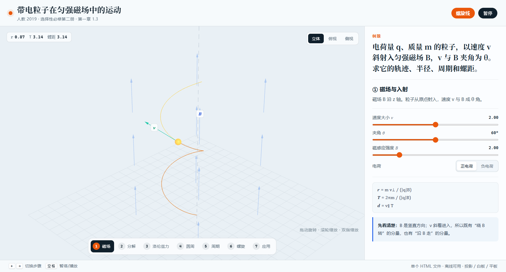

# 3D 课本插图

把课本里的一道题编译成可交互的 3D 课件：**能转、能调参、能一步步讲**，每个成品都是单个 HTML，双击就开、离线可用。

在线看：<https://pengyuyan3d.github.io/textbook3d/>

| 场景 | 教材 | 交互 |
| --- | --- | --- |
| [带电粒子在磁场中的运动](https://pengyuyan3d.github.io/textbook3d/demos/lorentz.html) | 人教 2019 · 选择性必修二 · 第一章 | 7 步讲解；v / θ / B 三个滑杆；实时算半径 r、周期 T、螺距 d |
| [单摆](https://pengyuyan3d.github.io/textbook3d/demos/pendulum.html) | 高中物理 · 机械振动 | 摆长与 g 可调；摆动、受力、周期一起看 |
| [正方体的截面](https://pengyuyan3d.github.io/textbook3d/demos/cube-section.html) | 人教 A 版 · 必修二 · 第八章 | 倾角 / 方位 / 位置三个滑杆；三角形到正六边形逐步切出 |



## 为什么这么做

课本是一张静态图，学生只能想象它转起来的样子；老师在黑板上画 3D 更难。
这类课件要解决的不是「做个 3D 动画」，而是 **把一道题拆成能按步骤讲的状态**：每一步该显示什么、哪个参数在变、公式读数跟着谁变。

所以这里的结构是「场景数据 + 播放器」：

```
fixtures/<scene>.json   题目、步骤、参数、讲解词
scenes/<scene>.js       这个知识点的几何与动画
engine/                 播放器（步骤条、滑杆、视角、公式面板）
scripts/build.mjs       把 CSS/JS/three.js 内联成一个 HTML
```

加一个新知识点 = 写一份 JSON + 一个场景模块，不用动播放器。

## 本地打开

```bash
# 直接看成品
open dist/pendulum.html      # 双击也行

# 重新构建单文件（需要 node）
node scripts/build.mjs fixtures/pendulum.json
```

## 边界

- 只覆盖了几个知识点，不是完整课程库；磁场是匀强场，没有边界场与相对论效应。
- 轨迹用解析解算，所以没有数值漂移，但也没有碰撞、辐射等次要效应。
- 需要浏览器支持 WebGL2；老设备要另做视频兜底。

## 许可

代码可自由修改使用；`engine/vendor/three.min.js`、`OrbitControls.js` 为 three.js（MIT）。
